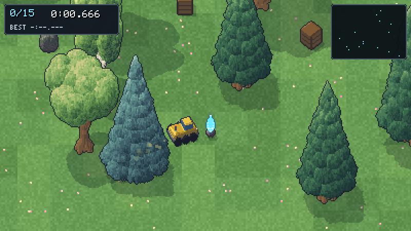

# Slice Engine 1.1

A small engine for **sprite-stacked pixel-art games** in the browser, taken out of
the Slice Drive racing game and made general.

Objects are stacks of horizontal slices (a voxel grid). The engine turns each
stack into crisp pixel sprites for 64 headings, lit by a sun you choose, with
outlines and ground shadows, and draws a depth-sorted world from them. Around
that it gives you what a new game needs on day one: a fixed-step game loop,
keyboard, touch and gamepad input, a follow camera, synthesised sound and music,
particles, a pixel font, menus, collisions, saves and procedural trees.

- **No build step, no dependencies.** Plain ES modules. Open a page and it runs.
- **No asset files needed.** Models can be built in code or ASCII; sound is
  synthesised; the font is in code. PNG slice sheets work too when you have art.
- **Baked sprites.** Heading and lighting are baked into cached pictures. A
  scene can draw at native pixel scale or magnify those pictures with a
  fractional camera. Cached pictures are rebuilt after canvas loss.



## Quick start

```bash
npm run serve
```

Then open http://localhost:8090/examples/. (ES modules need `http://`;
opening the files straight from disk will not work.)

The smallest program:

```html
<!doctype html>
<div id="game" style="position:fixed;inset:0"></div>
<script type="module">
import {Model, createScreen, createScene, startLoop} from './src/index.js';

const screen = createScreen({width: 320, height: 180, parent: document.querySelector('#game')});
const b = Model.builder(12, 12, 12, [[186, 140, 84], [128, 90, 52]]);   // 12 × 12 × 12 voxels, two colours
b.box(0, 0, 0, 11, 11, 11, 1);                                         // a solid box of colour 1
b.box(0, 0, 11, 11, 11, 11, 2);                                        // a darker lid
const crate = Model.thing(b);
const scene = createScene();

startLoop({
  update(dt) {},
  draw(info) {
    screen.clear('#5e7d5a');
    scene.clear();
    scene.add({thing: crate, heading: info.time, x: 160, y: 100});      // turns slowly
    scene.draw(screen.context, {viewX: 0, viewY: 0, viewW: 320, viewH: 180});
  },
});
</script>
```

## Examples

| Example | Shows |
| --- | --- |
| [01-hello-stack](examples/01-hello-stack/) | A model built in code, turning; shadows; recolouring; the four times of day. |
| [02-model-viewer](examples/02-model-viewer/) | Models from code, ASCII layers and a PNG slice sheet. Drop your own sheet on the page. |
| [03-crystal-rover](examples/03-crystal-rover/) | A small complete game: driving, collisions, pushable crates, trees, particles, sound and music, title / pause / results menus, settings and a best time saved, touch controls, a minimap. |
| [04-tutorial](examples/04-tutorial/) | Garden Cart, the game the [tutorial](docs/tutorial.md) builds step by step. |

## Documentation

- [Changelog](CHANGELOG.md)
- [docs/tutorial.md](docs/tutorial.md): build a game from an empty page, in eight steps.
- [docs/concepts.md](docs/concepts.md): how it works. Coordinates, headings, slices, materials, lighting, memory, the loop.
- [docs/api.md](docs/api.md): every module and function.
- [docs/making-models.md](docs/making-models.md): code, ASCII and PNG slice sheets; a brief for artists.
- [CLAUDE.md](CLAUDE.md): rules for working on the engine itself.

## What is in `src/`

| Module | Import as | What it does |
| --- | --- | --- |
| `voxel.js` | `Voxel` | The slice renderer: baked sprites, pivoted and mirrored poses, pose attachments, lighting presets, signed shadows, and the memory budget. |
| `model.js` | `Model` | Making models: `builder` (boxes, blobs, cylinders, wheels, mirroring), `fromLayers` (ASCII), `fromSliceImage` (PNG sheets), `pack`/`unpack` (JSON), and `thing()`, a model drawn at a world heading. Seeded `random` and `hash`. |
| `scene.js` | `Scene` | Depth-sorted drawing and culling, with optional zoom and fractional positioning. |
| `camera.js` | `Camera` | Bounded follow camera and interpolated zoom views with coordinate conversion. |
| `screen.js` | `Screen` | Pixel-art display with optional high-DPI backing, pointer mapping, colour grading, and canvas recovery. |
| `loop.js` | `Loop` | `requestAnimationFrame` loop with fixed simulation steps; pause; `step()` for tests. |
| `clock.js` | `Clock` | Fixed steps from wall time or supplied simulation time, with interpolation progress. |
| `input.js` | `Input` | Keyboard, touch buttons and gamepad merged into named actions: `held`, `pressed`, `axis`, `stick`, an action queue for menus. |
| `audio.js` | `Sfx` | Web Audio synth: effects by name, your own effects, a step-sequencer for music, volumes, pause. |
| `particles.js` | `Particles` | Pooled pixel particles: smoke, dust, sparks, flames, spray, confetti and your own kinds. |
| `gfx.js` | `Gfx` | Pixel fonts in code, text, panels, time formatting. |
| `ground.js` | `Ground` | Tiled ground painting and height-map slice projection. |
| `sky.js` | `Sky` | Celestial position from latitude, declination and local time. |
| `waves.js` | `Waves` | Shared travelling wave field for rendered crests and simulated motion. |
| `reflections.js` | `Reflections` | Masked reflections, ripples, and other effects clipped to a surface. |
| `trees.js` | `Trees` | Eight species of procedural trees in four seasons, three sizes each, with wind bends. |
| `collide.js` | `Collide` | Circles and boxes, pushing apart with bounce and mass, a spatial grid. |
| `storage.js` | `Storage` | Versioned saves in `localStorage` that never throw. |
| `menu.js` | `Menu` | Pixel menus driven by input actions, with values, left/right changes and pointer hits. |

`src/index.js` exports each as a namespace (`Voxel`, `Model`, ...) plus the
factories (`createScreen`, `createScene`, `createCamera`, `startLoop`,
`createStore`, `createMenu`, `createGrid`, `createReflections`) and the model helpers.

## Tools

- `node tools/serve.js [port]`: a static server for the examples and your game.
- `node tools/model-to-sheet.js <module.js> <export> <out.png> [columns] [gap]`: export a model
  built in code as a PNG slice sheet, for an artist to paint over.
- `node tools/fit-sheet.js <template.png> <paint.png> <out.png>`: fit painted shading to an exported voxel grid.
- `tools/png.js`: a tiny PNG reader and writer for your own Node tools.

## Tests

```bash
npm test
```

Runs `tests/*.test.js` under Node with a stand-in canvas (`tests/fake-canvas.js`):
baking, headings, ASCII and sheet loading, lighting, the memory budget, the clock,
particles, collisions, saves, the scene's draw order, the camera, text, menus,
input and trees. Use `tests/fake-canvas.js` the same way in your own game's tests.

## Starting a new game from it

1. Copy `src/` into your project (or add this repository as a git submodule),
   and import from it: `import {...} from './engine/src/index.js'`.
2. Copy `examples/04-tutorial/` (small) or `examples/03-crystal-rover/` (more
   complete) as the starting point, and change the import path.
3. Keep `update()` (the game's rules, in fixed steps) apart from `draw()` (only
   pictures). See [docs/concepts.md](docs/concepts.md#the-loop-steps-and-frames).

## Limits worth knowing

- `createCamera()` uses whole-pixel positioning. Use `Camera.view()` for a
  fractional zoom and choose model resolutions to suit your zoom range.
- `applyGrade` tints everything drawn before it, glowing things included. For
  lamps that stay bright at dusk, draw them after the grade (Slice Drive keeps
  them on a separate layer).
- The font is upper case ASCII only. `Gfx.addGlyph` adds characters.
- Each Thing at 64 headings is 64 pictures: use `frames: 4` or `8` for things
  that never turn, and `warm()` while loading so nothing bakes mid-play.

## Origin

The renderer (`voxel.js`), particles, the pixel font, ground tiles, trees, the
fixed-step clock, the sound building blocks and much of the input code come from
Slice Drive (`dist/js/` in that project), with the racing parts taken out. The
scene, camera, screen, loop, model builders, collisions, saves and menus were
written for the engine, after the way Slice Drive does them.

## Licence

MIT: see [LICENSE](LICENSE).
